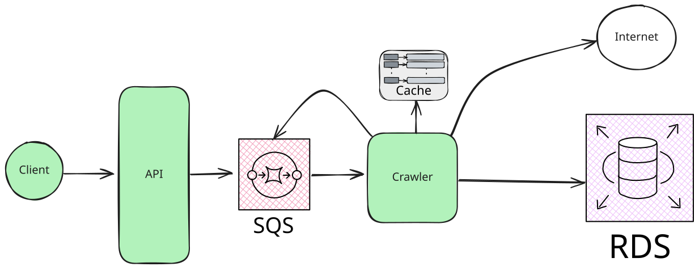

# High level overview
In a production ready component I would use managed (cloud) components to build a crawler like the one described by the [functional requirements](./REQUIREMENTS.md).
The architecture that I followed is the following

Every box of the diagram is an interface in the code with an in-memory implementation, so the application runs on a laptop and could be deployed with managed services by replacing the implementation. I will go more in detail on each part.

## Client and API
**This was not required by the definition of the test**: I just needed to pass a URL and make it trigger the crawler. But because I am coding in Java with Spring Boot, I exposed an endpoint to start a crawl and one to see the progress:

* `POST /crawl?url=https://monzo.com/` *simulates* adding a new URL to the queue. It answers `202 Accepted`.
* `GET /` shows the queue length, the crawls (with their state and the number of pages) and the counters.

## Queue (SQS)
This can be any queue, not only SQS (`CrawlQueue`). Having an external queue simplifies quite a lot the work, because at that point the crawler is a worker that consumes from the queue, and temporary unavailability of a page can be handled by the retry mechanism of the queue. The queue contains the URLs that the crawler(s) still have to process.
The in-memory implementation is a `LinkedBlockingQueue`: the workers wait on it without polling.

## Cache of visited pages (Redis)
The crawler implements, in an asynchronous and distributed way, a breadth first search, and it enqueues any ***new*** link that it still needs to visit. To do that it needs to store the list of the links that are already visited (`VisitedStore`). A cache that guarantees atomic operations (Redis, Memcached) is a good choice, because it is faster than a database. Using a database is possible, but it requires configuring it for consistency, that usually means a slower access in a cluster and a lower availability.
The one operation that matters is `markVisited`, which tells to **exactly one** of the concurrent callers that the page was not visited before. The in-memory implementation is a concurrent set per host (in Redis it would be `SADD`, or `SET NX`).
Visited pages are kept per host, so crawling a host again forgets only that host. With a real cache a time to live would do the same.

## Database (RDS)
Not requested for this test, but depending on the use case the data may need to be recorded. A document store (OpenSearch) or a database with a high write throughput (Cassandra) would be a good choice. The requirement was to `print the page that [the crawler] visits and list all the links it finds at the specific page`: the output goes through the `CrawlReporter` interface, whose implementation prints on the standard output.

## The crawler
The crawler is a component that receives new tasks (messages from the queue), checks whether they are already visited, downloads the page from the internet (`PageFetcher`), parses it, reports it, and adds the new links of the same host to the queue. Depending on the use case it can be a lambda or a long running task (a Fargate task): in this project it is a set of virtual threads (`CrawlerWorkers`), each of them doing that in a loop.

### When is a crawl over?
Every crawl (`CrawlSession`) counts the links that are in the queue or being visited. A link is counted when it is queued and uncounted when its visit ends (successfully or not), so the count reaches zero exactly when there is no more work. With a distributed queue the counter lives in the shared cache.

### Failures
* A page that fails (HTTP error, not HTML, timeout, parsing bug) is counted and logged, and the crawl goes on.
* A worker never stops because of a page.
* If the application stops, the in-memory queue is lost: with a durable queue the crawl would continue.
